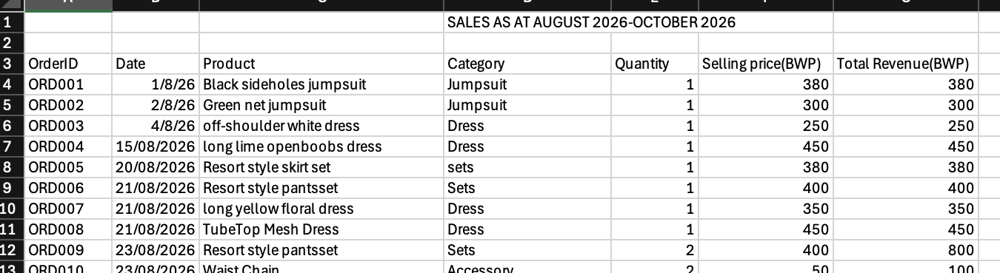
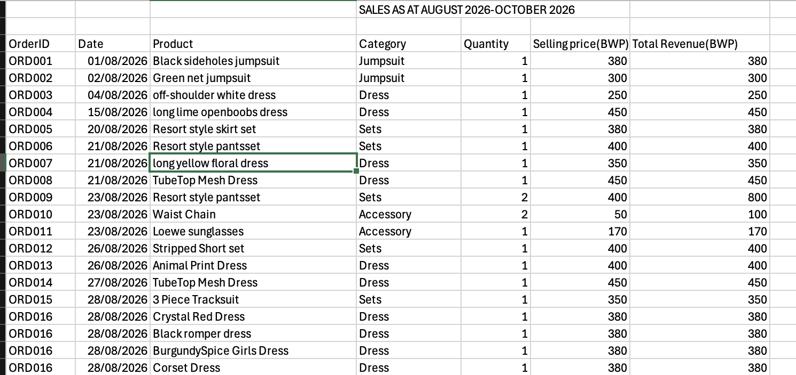

# Boutique Sales Performance Analysis

Tools: Microsoft Excel

Industry: Fashion Retail

Project Status: In Progress

## 1. Project Overview

This project focuses on analysing sales performance of a home based women's clothing boutique that primarily markets its products through social media.

Sales transactions were initially recorded in a notebook, capturing the date of sale, product, quantity and selling price. Although these records provided a basic record of daily transactions, they made it difficult to analyze sales trends, compare product performance and evaluate overall sales revenue.

The purpose of this project is to transform these handwritten records into a structured Excel dataset, perform data cleaning and analysis, and develop a visual dashboard to support business decision-making.

## 2. Business Objectives

The project aims to answer the following questions:

1. What is the total sales revenue during the selected period?
2. Which clothing products and categories generate the most revenue?
3. How does sales performance vary across months?
4. Which products should the boutique consider prioritizing when restocking?

## 3. Data Collection

Historical sales records were collected from the boutique's handwritten notebook and transferred into Microsoft Excel. The records were consolidated into a single worksheet containing sales transactions from different months.

Each purchase was assigned a unique Order ID, with multiple products purchased in the same transaction recorded separately under the same identifier.

The dataset includes the following fields:

- Order ID
- Date
-  Product
-  Category
-  Quantity
-  Unit Selling Price (BWP)
-  Total Revenue (BWP)

### Structured Sales Dataset

*Figure 1: Initial sales records transferred into Excel.*

## 4. Data Cleaning and Preparation

After transferring the handwritten sales records into Microsoft Excel, I reviewed the dataset to identify inconsistencies, correct inaccurate entries and ensure that the data was suitable for analysis.

### 4.1 Data Cleaning Process

The following cleaning and validation activities were performed:

- Product category standardization : Standardized inconsistent category names, including Dresses and Sets, to ensure uniform classification of products.

- Date formatting: Standardized transaction dates into DD/MM/YYYY format to support accurate sorting and analysis across different periods.

- Data verification: Cross-checked the Excel records against the original handwritten sales notebook to confirm the accuracy of the captured information.

- Quantity and price validation: Reviewed product quantities and selling prices, identified incorrectly entered values and corrected them using the original notebook records.

- Revenue verification: Checked revenue calculations to ensure that each product's total revenue was correctly calculated by multiplying quantity by unit selling price.

- Missing value assessment: Examined the dataset for blank entries and confirmed that no missing values were identified in the required fields.

- Duplicate record assessment: Reviewed the data for accidental duplicate transactions. No duplicate transactions were identified.

### 4.2 Data Cleaning Evidence

The following examples illustrate the corrections and validation activities performed during data preparation.

### Before cleaning

*Figure 2 : Sales dataset before data cleaning. *

### After cleaning

 

*Figure 3: Sales dataset after standardization and correction.*

.
